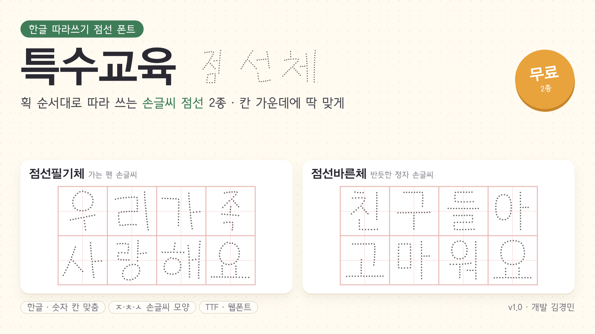

# 특수교육 점선체



한글 **따라쓰기용 점선 폰트** 2종입니다. 손글씨 획의 가운데를 따라 점을 찍어, 아이들이 획 순서대로 따라 쓸 수 있게 만들었습니다.
특수교육 현장의 한글 쓰기 지도를 위해 만들었고, 누구나 무료로 쓸 수 있습니다.

| 폰트 | 느낌 | 원본 폰트 | 한글 |
|---|---|---|---|
| **특수교육 점선필기체** | 가는 펜 손글씨 | 학교안심 꼬꼬마 R (KERIS · 디자인210) | 9,413자 |
| **특수교육 점선바른체** | 반듯한 정자 손글씨 | 나눔바른펜 R (네이버 · 윤디자인) | 11,172자 |

## 특징
- **획 가운데 한 줄 점선**: 끝점·꺾이는 곳·갈라지는 곳에 점이 찍혀 획 모양과 순서가 살아납니다(ㅈ·ㅊ·ㅅ도 손글씨 모양).
- **칸 맞춤**: 한글과 숫자가 정사각형 따라쓰기 칸 한가운데에 고른 크기로 들어갑니다. 두 폰트를 섞어 써도 같은 자리에 옵니다.
- **회색 점(#6B6A6A)**: 색 폰트를 지원하는 프로그램에서는 자동으로 회색으로 보입니다.
- **웹폰트 포함**: 웹사이트·웹앱에서 바로 쓸 수 있는 WOFF2와 CSS를 함께 제공합니다.

## 내려받기
[`dist/`](dist/) 폴더에서 받습니다. 파일을 누른 뒤 오른쪽 위 내려받기 버튼을 누르세요.

| 용도 | 파일 |
|---|---|
| 한글·워드 등에 설치 | `특수교육 점선필기체.ttf`, `특수교육 점선바른체.ttf` |
| 웹 개발 | `web/` 폴더 (WOFF2 2개, `fonts.css`) |

## 사용 방법
### 설치
TTF 파일을 두 번 눌러 '설치'를 누릅니다. 같은 이름의 폰트가 이미 설치되어 있으면 먼저 지웁니다.

### 따라쓰기 활동지 만들기 (한글 프로그램)
- 표 칸을 정사각형으로 만들고, 줄 간격 100%(고정), 칸 안 세로 정렬은 '가운데'로 합니다.
- 점이 검정으로 보이면 글자색을 `6B6A6A`(회색)로 지정합니다.
- 점선필기체에 없는 드문 한글(약 1,760자)은 다른 폰트로 대신 보입니다.

### 웹에서 쓰기
`dist/web/` 폴더를 프로젝트에 넣고 CSS를 연결합니다.
```html
<link rel="stylesheet" href="web/fonts.css">
<p style="font-family: '특수교육 점선필기체'">우리 반 친구들</p>
```
웹폰트에는 한글·영문·숫자·기본 문장부호만 들어 있습니다.

## 라이선스
두 폰트 모두 **[SIL 오픈 폰트 라이선스(OFL) 1.1](dist/OFL.txt)** 을 따릅니다.
- **무료로 사용·수정·재배포**할 수 있습니다. 단, **폰트 파일 자체를 판매할 수는 없습니다.**
- 이 폰트로 만든 활동지·학습지·문서·영상 등은 자유롭게 쓸 수 있고, 판매도 가능합니다.
- 수정해서 다시 배포할 때는 폰트 이름을 바꾸고, 원본 저작권 표시와 OFL 전문(`dist/OFL.txt`)을 함께 넣어 주세요.

| 폰트 | 원본 | 원본 저작권 |
|---|---|---|
| 점선필기체 | 학교안심 꼬꼬마 R | © KERIS (한국교육학술정보원), 디자인210 제작 |
| 점선바른체 | 나눔바른펜 R | © NAVER Corporation, 윤디자인 제작 ('나눔' 등 예약 폰트명은 쓰지 않음) |

## 만든 사람
- 개발: 김경민

## 직접 만들어 보기 (개발자용)
Python 3와 Node.js(npm)가 필요합니다.
```bash
pip install -r requirements.txt
./tools/fetch_source.sh         # 원본 폰트 2종 내려받기
DIST=1 ./tools/build_all.sh     # 2종 만들기 → build/, dist/ (4코어 약 15분)
```

| 도구 | 하는 일 |
|---|---|
| `tools/make_dotted.py` | 손글씨 폰트를 획 가운데 점선 폰트로 바꾸기 (칸 맞춤, ㅇ 보정, 색) |
| `tools/compose_hangul.py` | 원본에 없는 한글을 있는 글자의 조각으로 조립하기 |
| `tools/make_web.py` | 웹용 WOFF2와 CSS 만들기 |
| `tools/otf2ttf.py` | OTF(CFF) 원본을 TrueType으로 바꾸기 (다른 원본 폰트용) |
| `tools/preview.py` | 미리보기 그림 만들기 |
