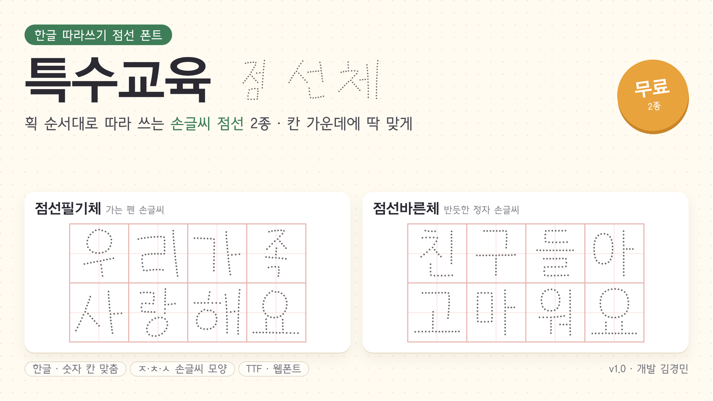

# 특수교육 점선체 v1.0



한글 따라쓰기용 점선 폰트 2종입니다.

| 파일 | 폰트 이름 | 원본 | 한글 | 라이선스 |
|---|---|---|---|---|
| `특수교육 점선필기체.ttf` | 특수교육 점선필기체 | 학교안심 꼬꼬마 R (KERIS, 디자인210) | 9,413자 | SIL OFL 1.1 → [OFL.txt](OFL.txt) |
| `특수교육 점선바른체.ttf` | 특수교육 점선바른체 | 나눔바른펜 R (NAVER, 윤디자인) | 11,172자 | SIL OFL 1.1 → [OFL.txt](OFL.txt) |

## 설치 (한글·워드 등)
TTF 파일을 내려받아 두 번 눌러 설치합니다. 같은 이름의 폰트가 이미 설치되어 있으면 먼저 지웁니다.
- 점 색은 기본 회색(#6B6A6A)입니다. 색 폰트를 지원하지 않는 프로그램에서는 검정으로 보이니 글자색을 6B6A6A로 지정하세요.
- 따라쓰기 칸: 정사각형 표 칸, 줄 간격 100%(고정), 칸 안 세로 가운데 정렬.
- 점선필기체에 없는 드문 한글 약 1,760자는 다른 폰트로 대체되어 보입니다.

## 웹 개발용 (`web/`)
웹 주소에서 다루기 쉽도록 웹폰트 파일 이름은 영어로 두었습니다.
`web/` 폴더의 WOFF2 2개와 `fonts.css`를 같은 곳에 두고 CSS를 연결합니다.
```html
<link rel="stylesheet" href="web/fonts.css">
<p style="font-family: '특수교육 점선필기체'">우리 반 친구들</p>
```
한글·영문·숫자·기본 문장부호만 들어 있습니다(한자 제외).

## 지켜 주세요
- 두 폰트 모두 SIL OFL 1.1을 따릅니다. 폰트 파일 자체는 판매할 수 없습니다.
- 이 폰트로 만든 활동지·학습지·문서는 자유롭게 쓸 수 있고 판매도 가능합니다.
- 수정해서 다시 배포할 때는 이름을 바꾸고, 원본 저작권 표시와 OFL 전문(`OFL.txt`)을 함께 넣습니다.

## 미리보기 이미지
- `미리보기_1280x720.png`: 블로그·발표 자료용
- `미리보기_1200x630.png`: 링크 공유 미리보기용

개발: 김경민
